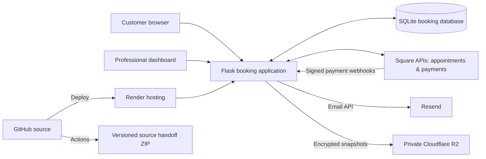

# Eye Candy Beauty Lounge — Booking & Payments Platform

**Production web application | Python / Flask · Square · Render · SQLite · Resend · Cloudflare R2 · GitHub Actions**

**Live site:** https://eyecandybeauty.me  
**Project type:** Real-world business application · Booking, payments, infrastructure and reliability  
**Milestone:** v1.0 production integration validation — November 2026  
**Portfolio scope:** Architecture and verified engineering outcomes; no customer data or private production source.

## Overview

Built and deployed a booking and payment platform for a multi-professional beauty business. The system combines customer appointment requests, staff scheduling, Square calendar synchronization, professional-specific payment connections, deposit checkout, customer notifications and encrypted recovery backups.

The project evolved through small, testable releases with sandbox validation before production payment processing.

## Architecture

*Simplified diagram. Application secrets and encrypted payment-connection keys remain outside public documentation.*

## Engineering highlights

- **Booking operations:** customer booking requests, professional dashboards, service configuration, schedules and appointment workflows.
- **Square integration:** Sandbox-tested bidirectional calendar reconciliation; production OAuth/location connection and merchant-specific deposit link creation.
- **Payment integrity:** Square payment events reconcile back to the correct appointment; deposit state is visible as **PAID / UNPAID / REVIEW**, rather than relying on staff-entered payment flags.
- **Email automation:** Resend-based deposit checkout links and guarded confirmation, cancellation, reschedule and reminder messages, with separate test and production authorization switches.
- **Recovery engineering:** SQLite consistency-checked backups, AES-256-GCM encrypted offsite objects in private Cloudflare R2, verified download/decrypt and recovery dry-run.
- **Change management:** Git-based releases, Render deployments and GitHub Actions-generated source handoff packages.

## Evidence-based validation

| Validation | Outcome |
|---|---|
| Sandbox booking and calendar reconciliation | Verified in controlled scenarios including reschedules and cancellations |
| Square production webhook delivery | `payment.created` and `payment.updated` test notifications returned HTTP 200 |
| Real production $1 deposit | Square succeeded; matching appointment displayed **Paid** in staff UI |
| Resend delivery | Diagnostic and appointment/deposit test messages were received in the controlled inbox |
| Square unpaid-link revocation | User-confirmed revocation of an unpaid production test link |
| Encrypted offsite recovery | R2 download/decrypt recovery dry-run passed; fresh launch backup verified |
| GitHub Actions artifact | Latest source handoff artifact successfully generated and downloaded |

**Validation limits:** Payment refunds and all professional-account configurations were not comprehensively tested. A final independent public-site smoke check was requested; do not infer availability from the integration tests alone. Automatic expiry was enabled; its full runtime behavior is not claimed here as independently verified.

## Security and reliability practices

- Separate Sandbox and Production configurations for payment integration.
- Maintenance-mode launch gating and staff-only access during controlled tests.
- Explicit feature flags for Square writes, payment webhooks, deposit emails, appointment emails and expiry processing.
- Payment-sensitive updates driven by verified Square processing, not a manually toggled “paid” button.
- Backup encryption key managed separately from the database and stored outside the source repository.
- No API keys, customer data, transaction identifiers, encryption secrets or production database included in the public case study.

## What I learned

This project connected application development with the operational responsibilities of network and security engineering: debugging HTTP 403 responses, tracing third-party API delivery, evaluating webhook reliability, protecting configuration secrets, building rollback points and validating offsite recovery without touching the live database.

## Next milestones

- Each professional self-manages services, schedules, and authorized Square connections.
- Optional professional booking-notification emails and editable account recovery email settings.
- Ongoing usability refinements based on staff feedback.
- Further automated validation of expiry, refund and recovery pathways.

**Note:** This portfolio repo is intentionally a public-facing technical case study. The production application source and customer/financial records should remain in separately access-controlled locations.
